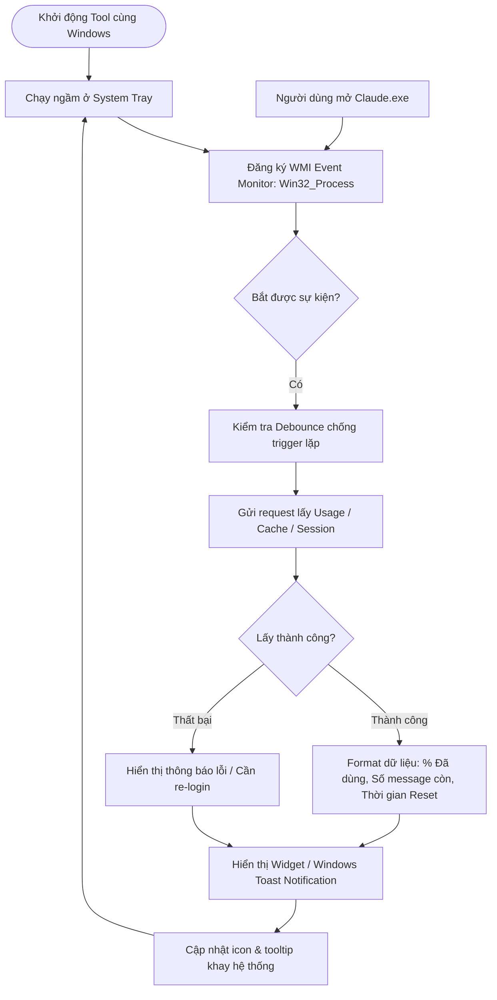

# Kế hoạch & Kiến trúc: Claude Usage Tracker (Windows)

Tài liệu này đề xuất phương án xây dựng một công cụ nhỏ (lightweight background tool) chạy ngầm trên Windows, tự động phát hiện khi Claude được khởi động và lập tức hiển thị thông số mức độ sử dụng (Usage / Limits / Token / Reset Time).

---

## 1. Phân tích bài toán & Cơ chế kỹ thuật

### 1.1. Phát hiện sự kiện Claude khởi động
Để công cụ phản hồi tức thì mà **không gây tốn CPU / RAM**:
- **Cơ chế tối ưu:** Sử dụng **WMI Event Listener** (`__InstanceCreationEvent` trên `Win32_Process`) hoặc **Windows Process Hook**. 
- Hệ điều hành sẽ tự động "đánh thức" tool khi xuất hiện tiến trình mục tiêu (ví dụ `Claude.exe` hoặc lệnh CLI `claude`), CPU khi ở trạng thái chờ gần như bằng **0%**.

### 1.2. Nguồn dữ liệu Usage (Cách lấy thông tin mức dùng)
Phụ thuộc vào loại tài khoản và phiên bản Claude bạn đang sử dụng:
1. **Claude Desktop (Gói Claude Pro / Max / Free):**
   - Claude Desktop không có public API chính thức đo quota còn lại.
   - *Cách xử lý:* Trích xuất session token an toàn từ Local Storage / Cookie của Claude Desktop (`%APPDATA%\Claude`) để gọi endpoint nội bộ (`api.claude.ai/api/organizations/.../chat_conversations` hoặc rate-limit headers), từ đó lấy số tin nhắn còn lại và thời gian reset chu kỳ (5 tiếng).
2. **Claude Code CLI / Anthropic Console (API Key):**
   - Đọc trực tiếp từ file cache/log của Claude Code (`~/.claude/` hoặc `%USERPROFILE%\.claude.json`) hoặc gọi Anthropic Usage/Billing API.

---

## 2. Sơ đồ luồng hoạt động (Workflow Diagram)

---

## 3. Danh sách tính năng đề xuất

### 3.1. Tính năng cốt lõi (Core MVP)
- [x] **Auto Detect**: Tự động phát hiện khi `Claude.exe` (hoặc Claude Code CLI) vừa khởi động.
- [x] **Instant Usage Display**: Hiển thị ngay thông tin:
  - Tỉ lệ đã sử dụng (%) hoặc số lượng quota còn lại.
  - Thời gian đếm ngược đến lúc reset chu kỳ (VD: *"Reset sau 2h 15m"*).
  - Trạng thái giới hạn tốc độ (Rate Limit Status).
- [x] **Lightweight Notification**: Hiển thị qua **Windows Native Toast Notification** (nhẹ, tự biến mất sau 5s, không che màn hình) hoặc **Mini Floating Pop-up** (HUD mờ góc dưới).
- [x] **System Tray Icon**: Nằm gọn ở khay hệ thống, click chuột phải có menu: *Xem chi tiết, Refresh thủ công, Cài đặt, Thoát*.

### 3.2. Tính năng nâng cao (Nên có)
- [ ] **Cảnh báo ngưỡng sử dụng**: Đổi màu icon (Xanh / Vàng / Đỏ) hoặc gửi cảnh báo khi mức dùng vượt quá 80% hoặc 95%.
- [ ] **Lịch sử & Thống kê**: Biểu đồ nhỏ xem tần suất chạm limit các ngày trong tuần.
- [ ] **Khởi động cùng Windows (Auto-start)**: Bật/tắt tùy ý qua 1 nút gạt.

---

## 4. Đề xuất Tech Stack

| Phương án | Công nghệ | Ưu điểm | Nhược điểm |
| :--- | :--- | :--- | :--- |
| **Lựa chọn 1 (Khuyên dùng)** | **Python (`pywin32` + `pystray` + `win10toast` / `CustomTkinter`)** | Phát triển cực nhanh, dễ tùy biến logic bóc tách token/API, đóng gói thành 1 file `.exe` duy nhất | Dung lượng file .exe đóng gói khoảng 15-20MB |
| **Lựa chọn 2 (Siêu nhẹ)** | **C# .NET (WPF / WinForms / Windows App SDK)** | Tích hợp sâu vào Windows Event, native 100%, RAM < 15MB, khởi động tức thì | Cần cài .NET Runtime (thường đã có sẵn trên Win 10/11) |
| **Lựa chọn 3** | **Rust + Tauri** | Hiệu năng cao, UI hiện đại cực đẹp | Thời gian build và setup phức tạp hơn |

---

## 5. Lộ trình triển khai (Dự kiến)

1. **Giai đoạn 1 - Core Probe (1-2 giờ):**
   - Viết module WMI bắt tiến trình `Claude.exe`.
   - Viết module bóc tách session/token hoặc kết nối API để đọc Usage.
2. **Giai đoạn 2 - UI & Notification (1-2 giờ):**
   - Tích hợp Windows Toast Notification / Popup HUD.
   - Tạo System Tray menu và trạng thái icon.
3. **Giai đoạn 3 - Đóng gói & Tinh chỉnh (1 giờ):**
   - Xử lý debounce (tránh Claude spawn nhiều tiến trình con gây spam thông báo).
   - Đóng gói file chạy độc lập (`.exe`) và cài đặt autostart.
